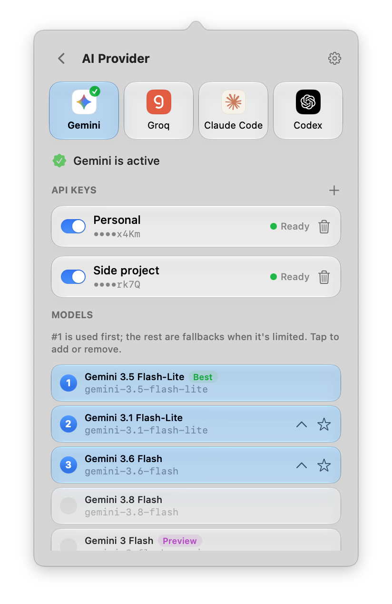
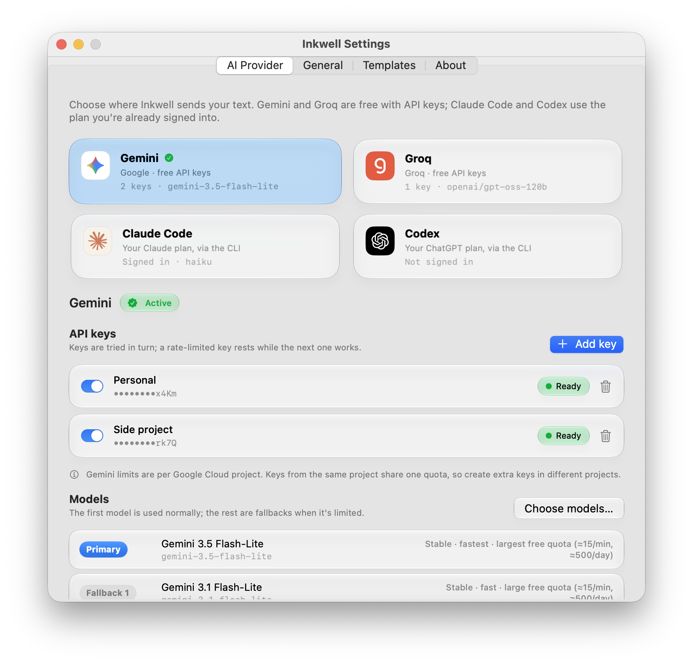

<div align="center">


# Inkwell

**AI writing help in every Mac app, from the menu bar.**

Type a trigger like `?fix` at the end of any text, and Inkwell replaces it with the result.<br>
Works with free Gemini and Groq keys, or the Claude Code and Codex plans you already have.

[](https://github.com/devrahulbanjara/inkwell/releases/latest)


[](LICENSE)

[](https://github.com/devrahulbanjara/inkwell/releases/latest/download/Inkwell.dmg)

[Report a bug](https://github.com/devrahulbanjara/inkwell/issues/new) · [Request a feature](https://github.com/devrahulbanjara/inkwell/issues/new)

<br>

<table>
  <tr>
    <td align="center" valign="top">
      <picture>
        <source media="(prefers-color-scheme: dark)" srcset="docs/screenshots/dashboard-dark.png">
        
      </picture>
    </td>
    <td align="center" valign="top">
      <picture>
        <source media="(prefers-color-scheme: dark)" srcset="docs/screenshots/providers-dark.png">
        
      </picture>
    </td>
  </tr>
</table>

</div>

## How it looks in use

```text
You type:   hey can u send me the reprot by tmrw ?fix
You get:    Hey, can you send me the report by tomorrow?

You type:   thanks for the invite, i cant make it thursday ?formal
You get:    Thank you for the invitation. Unfortunately, I won't be able to attend on Thursday.

You type:   what's the capital of australia ?ask
You get:    Canberra.
```

No copy-pasting into a chat window and no switching apps. It works in Mail, Slack, Notes, Messages, WhatsApp, browsers and most other places you can type.

## Triggers

| Trigger    | What it does                                            |
|------------|---------------------------------------------------------|
| `?fix`     | Fixes spelling, grammar and punctuation                 |
| `?rewrite` | Rewrites the text so it reads more clearly              |
| `?formal`  | Rewrites it in a polite, professional tone              |
| `?short`   | Makes it shorter without losing anything important      |
| `?ask`     | Answers the question or does what the text asks         |
| `?reply`   | Writes a reply underneath a message you received        |
| `?en`      | Translates to English                                   |

Every trigger is a template you can edit, turn off or add to in **Settings → Templates**. Each one either replaces the text or inserts the result below it.

## Providers

| Provider        | Cost                         | What you need                                                               |
|-----------------|------------------------------|-----------------------------------------------------------------------------|
| **Gemini**      | Free                         | An API key from [Google AI Studio](https://aistudio.google.com/apikey)      |
| **Groq**        | Free                         | An API key from [GroqCloud](https://console.groq.com/keys)                  |
| **Claude Code** | Included in your Claude plan | The `claude` CLI, signed in                                                 |
| **Codex**       | Included in your ChatGPT plan| The `codex` CLI, signed in                                                  |

For Gemini and Groq, only models on the free tier are offered. You pick a primary model and any fallbacks, and you can add as many keys as you like. When a key or model hits its rate limit, Inkwell rests it until the limit resets (it knows Gemini's daily quota resets at midnight Pacific) and moves on to the next one, so you rarely see an error.

> [!TIP]
> Gemini's free limits apply per Google Cloud project, not per key. Extra keys only add capacity if each comes from a different project.

Claude Code and Codex run headless from their own folder, `~/.inkwell`, with tools turned off and no saved sessions. They use the login you already have, so there's no API key to manage, and nothing ends up in your project folders or your normal chat history.

## Features

**Right in the menu bar.** Click the icon for usage stats and a card for the active provider. From there you can switch provider, add or remove keys, reorder models and send a test request without opening a settings window.

**Quick controls on right-click.** Right-click the icon to pause Inkwell, switch provider or model, turn keys on and off, or toggle individual triggers.

<div align="center">
  
</div>

**Usage dashboard.** Runs, tokens in and out, words processed and AI response time for the last 7 days, 30 days or all time, with a daily chart and your most-used triggers.

**Stays out of the way.** A small indicator appears at the top of the screen while the AI works and never takes focus from what you're typing.

<div align="center">
  <picture>
    <source media="(prefers-color-scheme: dark)" srcset="docs/screenshots/hud-dark.png">
    
  </picture>
</div>

**Undo works.** Results are pasted the normal way, so <kbd>⌘</kbd> <kbd>Z</kbd> brings your original text back, and your clipboard is restored afterwards.

**Native and light.** Pure Swift and SwiftUI with no third-party dependencies. It uses Liquid Glass on macOS 26 and later and falls back to standard materials on macOS 14 and 15.

## Settings

The full settings window has everything from the menu bar plus templates, sounds, the floating indicator and launch at login.

<picture>
  <source media="(prefers-color-scheme: dark)" srcset="docs/screenshots/settings-dark.png">
  
</picture>

## Install

**Homebrew**

```sh
brew install --cask devrahulbanjara/inkwell/inkwell
```

**DMG:** [download Inkwell.dmg](https://github.com/devrahulbanjara/inkwell/releases/latest/download/Inkwell.dmg), open it and drag Inkwell into Applications. Older versions are on the [Releases](https://github.com/devrahulbanjara/inkwell/releases) page.

> [!IMPORTANT]
> Inkwell isn't notarized by Apple, so macOS blocks it the first time you open it. Go to **System Settings → Privacy & Security** and click **Open Anyway**.

### Getting started

1. Open Inkwell. A pen icon appears in the menu bar.
2. Allow Inkwell under **System Settings → Privacy & Security → Accessibility**. It needs this to read and replace text in other apps.
3. Click the icon, open the provider card, and add a Gemini or Groq key. If you'd rather use Claude Code or Codex, make sure the CLI is installed and signed in, then pick it there.
4. Type something in any text field, end it with `?fix`, and watch it change.

## How it works

1. A global key monitor keeps only the last 64 typed characters in memory. Nothing is logged or sent anywhere.
2. When those characters end in a trigger, Inkwell reads the focused text field through the macOS Accessibility API. If an app doesn't expose its text that way, it selects all and copies instead.
3. It removes the trigger, sends the text and the template's instruction to your chosen provider, and pastes the result back into the same field.
4. If you switched to another field while waiting, the result goes to your clipboard instead, so nothing is pasted in the wrong place.

## Privacy

- API keys are stored in the macOS Keychain.
- Usage stats live in `~/Library/Application Support/Inkwell` and never leave your Mac.
- Your text is sent only to the provider you pick, and only when you type a trigger.
- Password fields are never read; macOS blocks this with Secure Input.

## Building from source

You need Xcode, or the Command Line Tools with the macOS 26 SDK or newer. The app itself runs on macOS 14 and later.

```sh
git clone https://github.com/devrahulbanjara/inkwell.git
cd inkwell
swift run                      # run straight from source
ARCHS="" ./scripts/build.sh    # build/Inkwell.app for your Mac's architecture
./scripts/make-dmg.sh          # build/Inkwell-<version>.dmg
```

Running `./scripts/build.sh` without `ARCHS` builds a universal app, which needs full Xcode. To regenerate the screenshots in this README with sample data, run `INKWELL_SCREENSHOTS=docs/screenshots swift run`.

> [!NOTE]
> macOS ties the Accessibility permission to the app's code signature, and every local build gets a new one. If triggers stop working after a rebuild, toggle Inkwell off and on in Accessibility settings, or run `tccutil reset Accessibility io.github.inkwell`.

## Known limitations

- **Replace mode replaces the whole field.** It's meant for message boxes and short fields. In a long document, use a template set to insert below.
- **QWERTY shortcuts.** The keyboard shortcuts Inkwell simulates assume a QWERTY layout.
- **Some apps don't expose their text.** Inkwell falls back to copy and paste there, which works almost everywhere but can be slower.

## Contributing

Bug reports and pull requests are welcome. For anything bigger than a small fix, please open an issue first so we can agree on the approach.

## License

[MIT](LICENSE). Gemini, Groq, Claude and OpenAI names and logos are trademarks of their respective owners and are used only to identify each provider. Inkwell is not affiliated with or endorsed by them. Logo artwork is from [LobeHub Icons](https://github.com/lobehub/lobe-icons) (MIT).

---

<div align="center">

Made by **Rahul Dev Banjara** · [Website](https://rahuldevbanjara.com.np) · [LinkedIn](https://www.linkedin.com/in/devrahulbanjara/) · [GitHub](https://github.com/devrahulbanjara)

</div>
