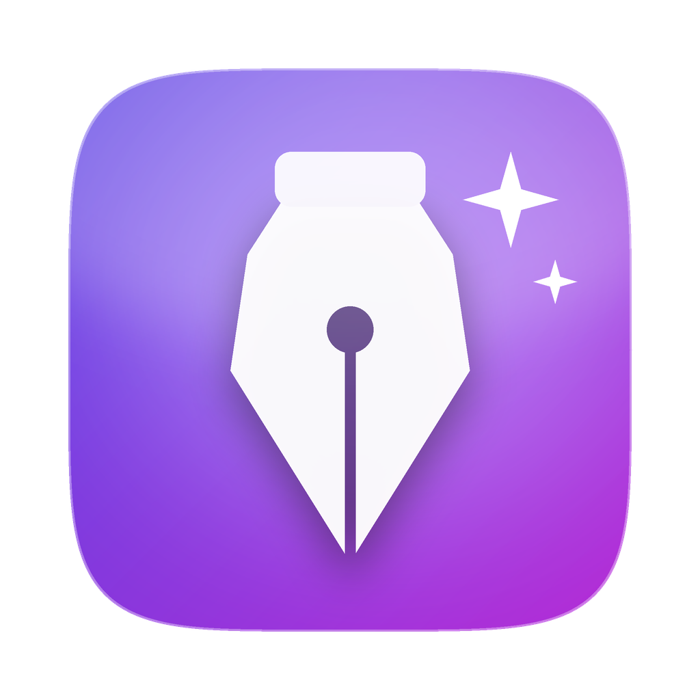
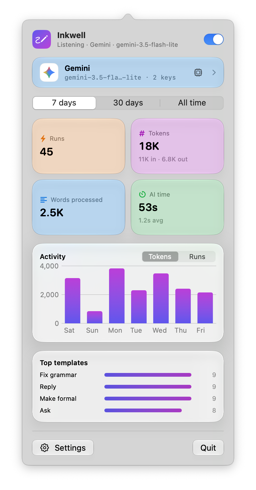
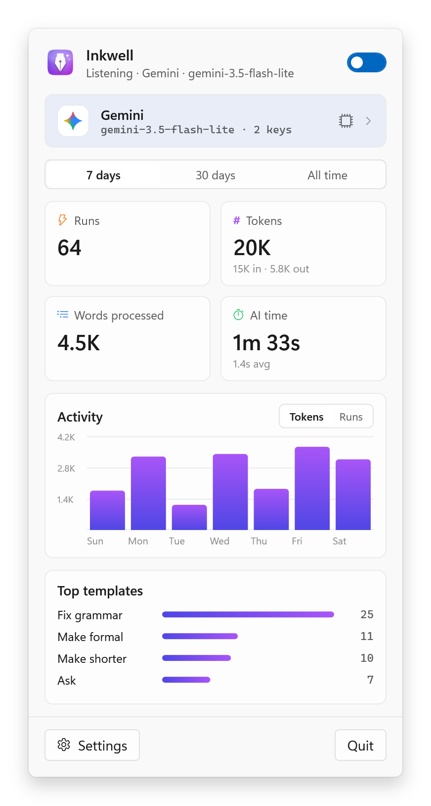
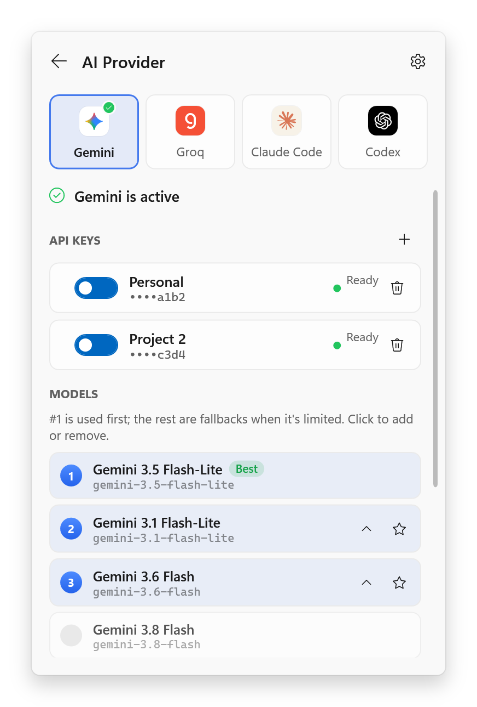
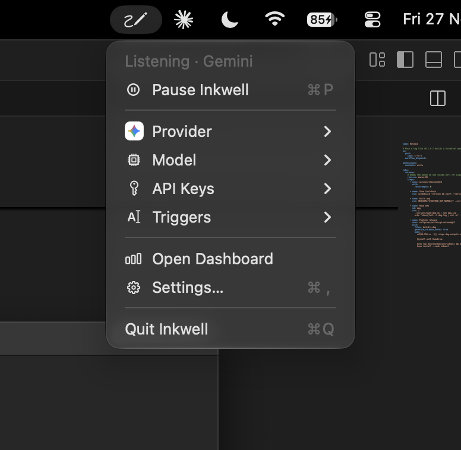
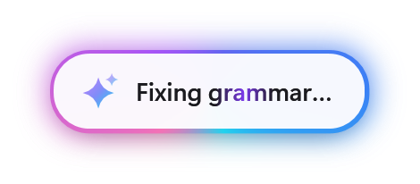
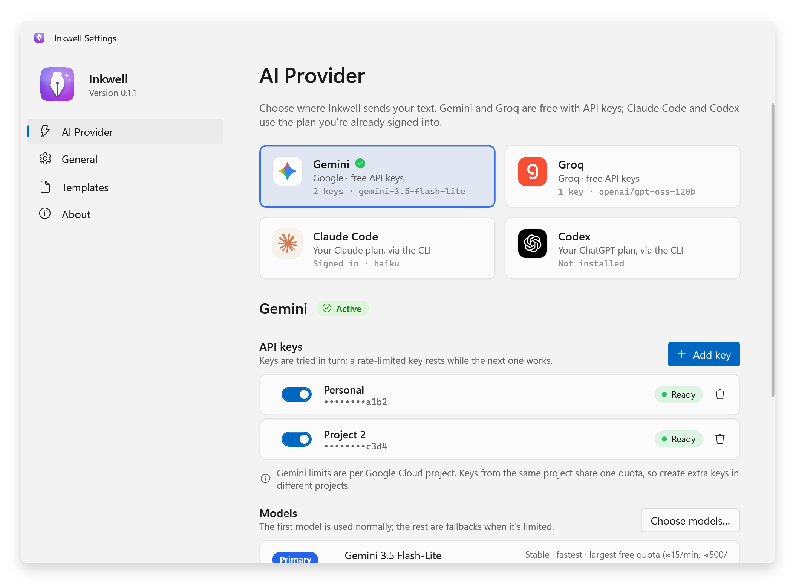

<div align="center">



# Inkwell

**AI writing help in every app, on Mac and Windows.**

Type a trigger like `?fix` at the end of any text, and Inkwell replaces it with the result.<br>
Works with free Gemini and Groq keys, or the Claude Code and Codex plans you already have.

[](https://github.com/devrahulbanjara/inkwell/releases/latest)


[](LICENSE)

[](https://github.com/devrahulbanjara/inkwell/releases/latest/download/Inkwell.dmg)
[](https://github.com/devrahulbanjara/inkwell/releases/latest/download/Inkwell-Setup.exe)

[Website](https://inkwell.rahuldevbanjara.com.np) · [Report a bug](https://github.com/devrahulbanjara/inkwell/issues/new) · [Request a feature](https://github.com/devrahulbanjara/inkwell/issues/new)

<br>

<table>
  <tr>
    <th>macOS — menu bar</th>
    <th>Windows — notification area</th>
  </tr>
  <tr>
    <td align="center" valign="top">
      <picture>
        <source media="(prefers-color-scheme: dark)" srcset="docs/screenshots/mac/dashboard-dark.png">
        
      </picture>
    </td>
    <td align="center" valign="top">
      <picture>
        <source media="(prefers-color-scheme: dark)" srcset="docs/screenshots/windows/dashboard-dark.png">
        
      </picture>
    </td>
  </tr>
  <tr>
    <td align="center" valign="top">
      <picture>
        <source media="(prefers-color-scheme: dark)" srcset="docs/screenshots/mac/providers-dark.png">
        
      </picture>
    </td>
    <td align="center" valign="top">
      <picture>
        <source media="(prefers-color-scheme: dark)" srcset="docs/screenshots/windows/providers-dark.png">
        
      </picture>
    </td>
  </tr>
</table>

</div>

## How it looks in use

```text
You type:   hey can u send me the reprot by tmrw ?fix
You get:    Hey, can you send me the report by tomorrow?

You type:   thanks for the invite, i cant make it thursday ?formal
You get:    Thank you for the invitation. Unfortunately, I won't be able to attend on Thursday.

You type:   what's the capital of australia ?ask
You get:    Canberra.
```

No copy-pasting into a chat window and no switching apps. It works in mail apps, Slack, Teams, Notes, Notepad, Word, WhatsApp, browsers and most other places you can type.

## Triggers

| Trigger    | What it does                                            |
|------------|---------------------------------------------------------|
| `?fix`     | Fixes spelling, grammar and punctuation                 |
| `?rewrite` | Rewrites the text so it reads more clearly              |
| `?formal`  | Rewrites it in a polite, professional tone              |
| `?short`   | Makes it shorter without losing anything important      |
| `?ask`     | Answers the question or does what the text asks         |
| `?reply`   | Writes a reply underneath a message you received        |
| `?en`      | Translates to English                                   |

Every trigger is a template you can edit, turn off or add to in **Settings → Templates**. Each one either replaces the text or inserts the result below it.

## Providers

| Provider        | Cost                         | What you need                                                               |
|-----------------|------------------------------|-----------------------------------------------------------------------------|
| **Gemini**      | Free                         | An API key from [Google AI Studio](https://aistudio.google.com/apikey)      |
| **Groq**        | Free                         | An API key from [GroqCloud](https://console.groq.com/keys)                  |
| **Claude Code** | Included in your Claude plan | The `claude` CLI, signed in                                                 |
| **Codex**       | Included in your ChatGPT plan| The `codex` CLI, signed in                                                  |

For Gemini and Groq, only models on the free tier are offered. You pick a primary model and any fallbacks, and you can add as many keys as you like.

**Limits are handled for you.** When a key or model hits a limit, Inkwell rests it until it resets and moves on to the next one, so you rarely see an error. It knows the difference between per-minute and daily limits: Gemini's daily quota resets at midnight Pacific, and Groq tells it exactly how long to wait. Claude Code's 5-hour and weekly limits and Codex's usage limits are recognised too. Inkwell shows which limit you hit and when it resets, for example *"Claude Code's 5-hour limit is reached. Resets 3:00 PM."*, and points you to a provider that's ready. It won't keep retrying a limit that's still in force.

> [!TIP]
> Gemini's free limits apply per Google Cloud project, not per key. Extra keys only add capacity if each comes from a different project.

Claude Code and Codex run headless from their own folder, `~/.inkwell`, with tools turned off and no saved sessions. They use the login you already have, so there's no API key to manage, and nothing ends up in your project folders or your normal chat history.

## Features

**Always one click away.** Click the menu bar icon (Mac) or the tray icon (Windows) for usage stats and a card for the active provider. From there you can switch provider, add or remove keys, reorder models and send a test request without opening a settings window.

**Quick controls on right-click.** Right-click the icon to pause Inkwell, switch provider or model, turn keys on and off, or toggle individual triggers.

<div align="center">
  
</div>

**Usage dashboard.** Runs, tokens in and out, words processed and AI response time for the last 7 days, 30 days or all time, with a daily chart and your most-used triggers.

**Stays out of the way.** While the AI works, a small pill floats just above the field you're typing in. It says what's happening ("Fixing grammar…", "Making it formal…") with a colourful ring spinning around it, then turns green when it's done. If something goes wrong it says why, in plain words. It never takes focus from what you're typing.

<div align="center">
  <picture>
    <source media="(prefers-color-scheme: dark)" srcset="docs/screenshots/windows/hud-dark.png">
    
  </picture>
</div>

**Undo works.** Results are pasted the normal way, so <kbd>⌘</kbd> <kbd>Z</kbd> / <kbd>Ctrl</kbd> <kbd>Z</kbd> brings your original text back, and your clipboard is restored afterwards.

**Updates itself.** When a new version is out, Inkwell shows it in the dashboard and the right-click menu, and updates in one click. On the Mac it uses Homebrew if that's how you installed it; on Windows it downloads and runs the new installer quietly and starts again. Your settings and keys carry over.

**Native on both.** The Mac app is pure Swift and SwiftUI, with Liquid Glass on macOS 26 and later and standard materials on macOS 14 and 15. The Windows app is .NET 8 and WPF with Windows 11's Mica and Acrylic, Fluent controls, native menus, and light, dark and accent colours that follow your system. Neither has third-party dependencies.

## Settings

The full settings window has everything from the dashboard plus templates, sounds, the floating indicator, updates and launch at login.

<table>
  <tr><th>macOS</th></tr>
  <tr><td>
    <picture>
      <source media="(prefers-color-scheme: dark)" srcset="docs/screenshots/mac/settings-dark.png">
      
    </picture>
  </td></tr>
  <tr><th>Windows</th></tr>
  <tr><td>
    <picture>
      <source media="(prefers-color-scheme: dark)" srcset="docs/screenshots/windows/settings-dark.png">
      
    </picture>
  </td></tr>
</table>

## Install

### macOS

**Homebrew**

```sh
brew install --cask devrahulbanjara/inkwell/inkwell
```

**DMG:** [download Inkwell.dmg](https://github.com/devrahulbanjara/inkwell/releases/latest/download/Inkwell.dmg), open it and drag Inkwell into Applications. Older versions are on the [Releases](https://github.com/devrahulbanjara/inkwell/releases) page.

> [!IMPORTANT]
> Inkwell isn't notarized by Apple, so macOS blocks it the first time you open it. Go to **System Settings → Privacy & Security** and click **Open Anyway**.

1. Open Inkwell. A pen icon appears in the menu bar.
2. Allow Inkwell under **System Settings → Privacy & Security → Accessibility**. It needs this to read and replace text in other apps.
3. Click the icon, open the provider card, and add a Gemini or Groq key, or pick Claude Code or Codex if the CLI is installed and signed in.
4. Type something in any text field, end it with `?fix`, and watch it change.

### Windows

[Download Inkwell-Setup.exe](https://github.com/devrahulbanjara/inkwell/releases/latest/download/Inkwell-Setup.exe) and run it. It installs for your account only, with no admin prompt, and adds Inkwell to the Start menu. Windows 10 (1809+) and 11, x64 (ARM PCs run it through emulation).

> [!IMPORTANT]
> The installer isn't code-signed yet, so SmartScreen may say "Windows protected your PC". Click **More info → Run anyway**.

1. Inkwell opens its dashboard above the taskbar. Its icon lives in the notification area. Windows 11 tucks new icons behind the **^** arrow; drag it onto the taskbar to keep it in view.
2. Open the provider card and add a Gemini or Groq key, or pick Claude Code or Codex if the CLI is installed and signed in. Windows needs no extra permission.
3. Type something in any text field, end it with `?fix`, and watch it change.

## How it works

1. A global key monitor keeps only the last 64 typed characters in memory. Nothing is logged or sent anywhere.
2. When those characters end in a trigger, Inkwell reads the focused text field through the system's accessibility API (Accessibility on macOS, UI Automation on Windows). If an app doesn't expose its text that way, it selects all and copies instead.
3. It removes the trigger, sends the text and the template's instruction to your chosen provider, and pastes the result back into the same field.
4. If you switched to another field while waiting, the result goes to your clipboard instead, so nothing is pasted in the wrong place.

## Privacy

- API keys are stored in the macOS Keychain, or encrypted with Windows DPAPI for your user account.
- Settings and usage stats live in `~/Library/Application Support/Inkwell` (Mac) or `%LOCALAPPDATA%\Inkwell` (Windows) and never leave your computer.
- Your text is sent only to the provider you pick, and only when you type a trigger.
- Password fields are never read. macOS blocks them with Secure Input, and on Windows Inkwell skips fields marked as passwords.
- The temporary clipboard entry used for pasting is kept out of Windows clipboard history.
- The only other network request is a check of this repository's latest release, for update notices.

## Repository layout

```text
mac/        Swift package for the macOS app (Sources/, Resources/, scripts/, homebrew/)
windows/    .NET 8 / WPF app (Inkwell/), unit tests (Inkwell.Tests/), installer/, scripts/
docs/       README screenshots for both apps
website/    inkwell.rahuldevbanjara.com.np
.github/    CI for both apps, and the release workflow (DMG, Windows installer, Homebrew tap)
```

## Building from source

### macOS

You need Xcode, or the Command Line Tools with the macOS 26 SDK or newer. The app itself runs on macOS 14 and later.

```sh
git clone https://github.com/devrahulbanjara/inkwell.git
cd inkwell/mac
swift run                      # run straight from source
ARCHS="" ./scripts/build.sh    # build/Inkwell.app for your Mac's architecture
./scripts/make-dmg.sh          # build/Inkwell-<version>.dmg
```

Running `./scripts/build.sh` without `ARCHS` builds a universal app, which needs full Xcode. To regenerate the Mac screenshots with sample data, run `INKWELL_SCREENSHOTS=../docs/screenshots/mac swift run`.

> [!NOTE]
> macOS ties the Accessibility permission to the app's code signature, and every local build gets a new one. If triggers stop working after a rebuild, toggle Inkwell off and on in Accessibility settings, or run `tccutil reset Accessibility io.github.inkwell`.

### Windows

You need the [.NET 8 SDK](https://dotnet.microsoft.com/download/dotnet/8.0), and [Inno Setup 6](https://jrsoftware.org/isinfo.php) for the installer (`winget install JRSoftware.InnoSetup`).

```powershell
git clone https://github.com/devrahulbanjara/inkwell.git
cd inkwell\windows
dotnet run --project Inkwell         # run straight from source
dotnet test                          # unit tests
.\scripts\build.ps1 -Version 0.2.0   # publish\Inkwell.exe (self-contained) + publish\Inkwell-Setup.exe
```

To regenerate the Windows screenshots with sample data, run a debug build with `--screenshots ..\docs\screenshots\windows`.

### Releasing

Push a tag like `v0.2.0`. The release workflow builds the universal Mac app and DMG, attaches the Windows installer to the same release, and updates the Homebrew tap. Both apps then offer the update to existing users.

## Known limitations

- **Replace mode replaces the whole field.** It's meant for message boxes and short fields. In a long document, use a template set to insert below.
- **QWERTY shortcuts on Mac.** The keyboard shortcuts Inkwell simulates on the Mac assume a QWERTY layout.
- **Apps running as administrator (Windows).** Windows doesn't let normal apps type into elevated windows. Run Inkwell as administrator too if you need triggers there.
- **Some apps don't expose their text.** Inkwell falls back to copy and paste there, which works almost everywhere but can be slower.

## Contributing

Bug reports and pull requests are welcome. For anything bigger than a small fix, please open an issue first so we can agree on the approach.

## License

[MIT](LICENSE). Gemini, Groq, Claude and OpenAI names and logos are trademarks of their respective owners and are used only to identify each provider. Inkwell is not affiliated with or endorsed by them. Logo artwork is from [LobeHub Icons](https://github.com/lobehub/lobe-icons) (MIT).

---

<div align="center">

Made by **Rahul Dev Banjara** · [Website](https://rahuldevbanjara.com.np) · [LinkedIn](https://www.linkedin.com/in/devrahulbanjara/) · [GitHub](https://github.com/devrahulbanjara)

</div>
